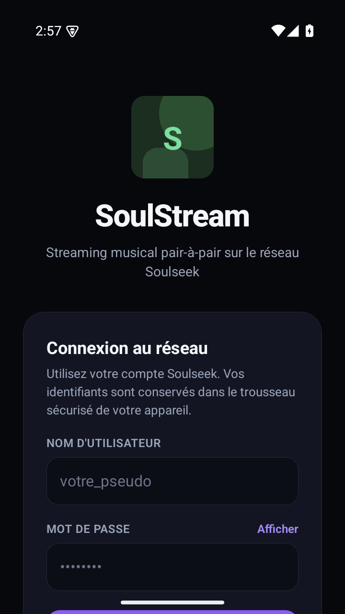
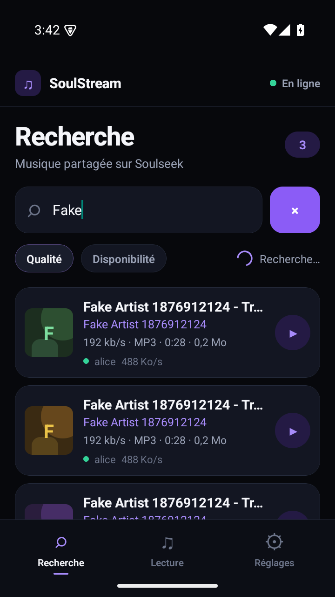
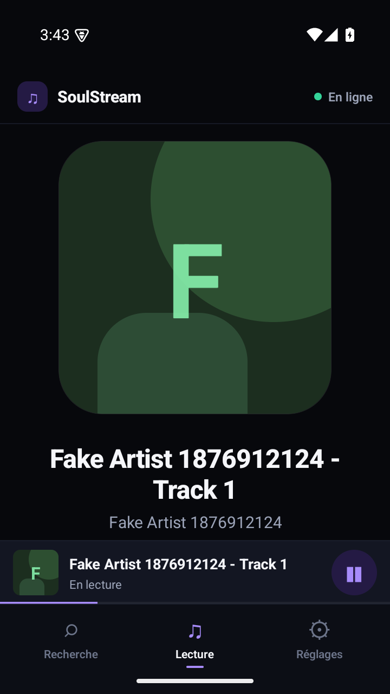

# SoulStream

Application **React Native (iOS / Android)** de streaming musical qui utilise le
réseau pair-à-pair **Soulseek**. Dépôt :
[Thibaut-Fontaine/soulseek-streaming](https://github.com/Thibaut-Fontaine/soulseek-streaming). Recherchez un morceau, choisissez une source,
et écoutez-le pendant que les octets arrivent du pair — sans serveur central de
streaming.

> **Usage responsable** — SoulStream ne fournit aucun catalogue ni aucun
> fichier. Le réseau Soulseek est alimenté par ses utilisateurs. N'écoutez et ne
> partagez que des œuvres que vous avez le droit d'utiliser. Le partage ou le
> téléchargement d'œuvres protégées sans autorisation peut être illégal dans
> votre pays.

---

## Téléchargement de l'APK

Une build Android de test est disponible ici :

**https://thibautfontaine.space/streaming/**

La page fournit l'APK, son empreinte SHA-256, les captures d'écran et l'archive
du code source. L'APK est signé avec une clé de développement : il s'installe
manuellement et n'est pas destiné à une publication sur le Play Store.

### Build actuelle (0.2.0)

La version publiée sur la page est construite depuis `main` et signée avec la
clé de développement. Elle inclut les architectures ARM (téléphones) et x86_64
(émulateurs), et son APK est aussi conservé dans
[`releases/SoulStream.apk`](releases/SoulStream.apk) pour les tests locaux.

La page vitrine [`showcase/index.html`](showcase/index.html) affiche le QR code
de téléchargement, les captures et les informations de build. Pour la
régénérer après une nouvelle build :

```bash
cd android && ./gradlew assembleRelease --no-daemon \
  -PreactNativeArchitectures=arm64-v8a,armeabi-v7a,x86_64 && cd ..
node tools/showcase.mjs android/app/build/outputs/apk/release/app-release.apk \
  --url https://thibautfontaine.space/streaming/SoulStream.apk
git add releases showcase && git commit -m "build: refresh APK and QR code"
```

Le script copie l'APK dans `releases/`, régénère le QR code et les informations
de build. Il refuse de tourner s'il reste des modifications non commitées dans
le code de l'application.

## Fonctionnalités

- Connexion au serveur Soulseek avec votre compte (`server.slsknet.org:2242`).
- Recherche sur le réseau, résultats enrichis (bitrate, durée, taille, nombre
  de personnes en file d'attente, vitesse moyenne du pair).
- **MP3 uniquement** : les résultats d'autres formats sont ignorés, ce qui
  réduit fortement la taille des transferts et permet un démarrage quasi
  instantané, sur iOS comme sur Android.
- **Recherche en un geste** : la requête est nettoyée localement, comparée aux
  résultats par distance de Levenshtein, et le premier match suffisant est
  lancé automatiquement. La recherche Soulseek est arrêtée dès que ce match
  est trouvé ; la lecture se prépare en arrière-plan.
- Streaming progressif : un serveur HTTP local avec support des requêtes
  `Range` alimente le lecteur natif (ExoPlayer / AVPlayer) au fur et à mesure
  que le transfert Soulseek avance.
- Lecture en arrière-plan, contrôles sur l'écran verrouillé et notification
  média via `react-native-track-player`.
- File d'attente du pair affichée en temps réel, annulation, réessai.
- Connexions indirectes (`ConnectToPeer` / `PierceFirewall`) pour fonctionner
  quand le téléphone n'est pas joignable directement.
- Requêtes réseau réduites : pas de recherche concurrente en double, cache
  d'adresses de pairs, rafraîchissement uniquement en cas d'échec, et suivi de
  file d'attente limité à un appel par minute.
- **Interface non bloquante** : les réponses de recherche tardives sont
  ignorées sans être décompressées, les gros lots sont plafonnés, et le proxy
  HTTP rend la main régulièrement pendant l'envoi au lecteur natif.
- Réglages : serveur, port d'écoute, port du proxy HTTP local, taille du tampon.
- Identifiants stockés dans le trousseau sécurisé (Keychain / Keystore).

## Aperçu

| Connexion | Recherche | Lecture |
| --- | --- | --- |
|  |  |  |

> Captures prises sur un émulateur Android 15, connecté au faux réseau de
> développement (`tools/fake-network.ts`).

## Aperçu de l'architecture

```
Écrans React Native (Recherche / Lecture / Réglages)
        │  zustand
        ▼
StreamingService ───────────────► SoulseekClient (TypeScript pur)
        │                              │
        │                              ├─ connexion serveur (TCP)
        │                              ├─ connexions pairs « P » (TCP)
        │                              └─ connexions fichiers « F » (TCP)
        │
        ▼
RangeHttpServer (127.0.0.1, HTTP/1.1 + Range)
        │
        ▼
ChunkBuffer (octets reçus, lecture par plages)
        │
        ▼
react-native-track-player (ExoPlayer / AVPlayer)
```

Le cœur Soulseek (`src/core`) est indépendant de React Native : il reçoit une
abstraction de transport (`src/transport/types.ts`). L'application utilise
`react-native-tcp-socket`, tandis que les tests et un éventuel relais Node
utilisent `node:net`.

Le « layer » de pré-recherche est entièrement local (`src/core/search.ts`) :
normalisation de la requête, suppression du bruit (« official video », bitrate,
etc.), puis scoring Levenshtein (ordre des mots, accents, petites fautes). Aucun
service LLM externe n'est appelé avant l'envoi à Soulseek.

### Flux d'un morceau

1. `FileSearch` (code serveur 26) → les pairs qui possèdent le fichier se
   connectent et envoient `FileSearchResponse` (code pair 9, compressé zlib).
2. `GetPeerAddress` (3) → adresse du pair ; connexion « P » + `PeerInit`.
3. `QueueUpload` (43) → le pair met le fichier en file.
4. Le pair envoie `TransferRequest` (40) avec un token et la taille.
5. On répond `TransferResponse` (41) en acceptant.
6. Le pair ouvre une connexion « F », envoie `FileTransferInit` (token brut),
   on répond par un offset 64 bits, puis les octets du fichier arrivent.
7. Les octets sont ajoutés à un `ChunkBuffer`, exposé par le serveur HTTP local
   avec `Accept-Ranges: bytes`. Le lecteur démarre dès que la cible de tampon
   est atteinte (par défaut 15 % du fichier, plafonné à 2 Mo).

Si le pair ne peut pas nous joindre directement (NAT, CGNAT), son client peut
envoyer `ConnectToPeer` au serveur ; le serveur nous transmet l'adresse et un
token, on se connecte au pair et on envoie `PierceFirewall`. C'est ce qui rend
le mode mobile utilisable dans de nombreux cas, sans redirection de port.

## Démarrage

### Prérequis

- Node.js ≥ 20, npm
- Android : JDK 17, Android SDK (API 35), un émulateur ou un appareil
- iOS : macOS, Xcode, CocoaPods

### Installation

```bash
npm install   # applique aussi patches/ via patch-package

# iOS uniquement
cd ios && pod install && cd ..
```

> **Compatibilité TrackPlayer** — deux ajustements sont nécessaires :
>
> 1. `react-native-track-player` 4.1.2 ne compile pas tel quel avec le Kotlin
>    2.1 de React Native 0.81 (deux `Bundle?` passés à une API non nulle).
>    `patches/react-native-track-player+4.1.2.patch` corrige ces deux lignes et
>    est réappliqué à chaque `npm install`.
> 2. Son module natif ne respecte pas encore le contrat TurboModule. La nouvelle
>    architecture est donc désactivée : `newArchEnabled=false` sur Android et
>    `:new_arch_enabled => false` dans le `Podfile` iOS.

### Lancement

```bash
npm start                 # Metro
npm run android           # ou : npx react-native run-android
npm run ios               # macOS : npx react-native run-ios
```

### Tests

```bash
npm test
```

La suite couvre l'encodage/décodage du protocole, le tampon de streaming, le
serveur HTTP à plages, et un **réseau Soulseek factice complet** (serveur +
pair) qui exerce le client réel : login, recherche compressée, file d'attente,
`TransferRequest`, connexion F directe **et** connexion indirecte
(`ConnectToPeer` / `PierceFirewall`).

### Tester l'interface sans compte Soulseek

Un faux serveur est fourni pour le développement :

```bash
# Terminal 1 : faux serveur + pair (écoute sur 22420 et 22421)
npx tsx tools/fake-network.ts

# Terminal 2 : émulateur Android
adb forward tcp:22345 tcp:22345      # port d'écoute de l'app -> hôte
adb reverse tcp:8081 tcp:8081        # Metro
```

Dans l'application, ouvrez « Serveur : … · modifier » sur l'écran de connexion,
mettez `10.0.2.2` / `22420`, puis connectez-vous avec n'importe quel
identifiant. Une recherche sur `Fake Artist` renvoie un WAV de démonstration
(fourni par le script) et permet de tester le streaming, le tampon et le
lecteur. Ce dispositif est réservé au développement.

## Réglages et réseau

| Réglage | Défaut | Rôle |
| --- | --- | --- |
| Serveur | `server.slsknet.org` | Serveur Soulseek |
| Port serveur | `2242` | Port TCP du serveur |
| Port d'écoute | `22345` | Port annoncé par `SetWaitPort` ; `0` = automatique |
| Port HTTP local | `0` | Proxy audio sur `127.0.0.1` ; `0` = automatique |
| Tampon | `2 Mo` | Plafond de préchargement avant lecture |

### Le problème du NAT (à lire)

Soulseek est un protocole ancien, sans hole-punching moderne. Pour de meilleurs
résultats (et pour que les recherches renvoient beaucoup de réponses), le port
d'écoute doit être **accessible depuis Internet** :

- sur un réseau Wi-Fi avec une box, redirigez le port d'écoute TCP vers le
  téléphone ;
- sur un réseau mobile, l'opérateur est souvent derrière un CGNAT : les
  connexions entrantes échouent. Les connexions indirectes sauvent une partie
  des cas (le pair nous demande de nous connecter à lui), mais pas tous ;
- le mode « avion »/VPN peut aider si le VPN fournit une adresse publique.

L'application reste fonctionnelle en lecture si le flux est déjà établi, mais
les nouvelles recherches et les nouveaux transferts peuvent échouer derrière un
NAT strict. C'est une limite du réseau, pas un bug de l'interface.

## Formats

SoulStream ne propose et ne transfère que des **MP3**. Les autres formats
(FLAC, OGG, WAV, M4A…) sont filtrés dès la recherche : ils sont plus volumineux
et ne sont pas lus nativement partout. Un MP3 de 5–10 Mo démarre presque
instantanément avec le tampon par défaut.

## Partage de fichiers : ce qu'il faut savoir

Le partage **n'est pas un drapeau du compte Soulseek** : c'est le client qui
déclare ses dossiers partagés au serveur et qui répond aux demandes de
téléchargement. Il n'existe donc pas de réglage « partager » à activer sur le
compte lui-même.

En revanche, la communauté l'attend fortement :

- les règles officielles de Soulseek tolèrent les clients alternatifs qui
  implémentent l'ensemble des fonctions du réseau, **y compris l'upload** ; les
  scripts qui n'implémentent pas toute la panoplie ne sont pas autorisés ;
- les autres utilisateurs voient le nombre de fichiers partagés et beaucoup
  utilisent une détection de « leech » ; ils peuvent refuser ou bloquer les
  utilisateurs qui ne partagent rien.

SoulStream partage les morceaux que vous avez déjà écoutés. Chaque
téléchargement terminé est gardé sur l'appareil (1 Go par défaut, les moins
récemment écoutés sont supprimés en premier). Ce dossier `SoulStream` est
déclaré au serveur (`SharedFoldersFiles`), il est consultable par les autres
utilisateurs, et ils peuvent y télécharger : 1 envoi à la fois, et par défaut
uniquement en Wi-Fi. Le partage se règle dans Réglages → Partage. Un morceau
déjà présent sur l'appareil est relu depuis le stockage, sans réseau.

Pour ne pas arriver sur le réseau avec un partage vide (certains pairs
refusent alors d'envoyer quoi que ce soit), **Réglages → Partage → Ajouter des
morceaux** ouvre le sélecteur de fichiers d'Android : les MP3 choisis sont
copiés dans le dossier `SoulStream` et annoncés au serveur aussitôt. Ces
morceaux ajoutés ne sont jamais supprimés pour faire de la place, ne comptent
pas dans la limite de 1 Go, et se retirent séparément. Les fichiers d'origine
ne sont pas modifiés.

SoulStream ne participe pas encore à l'arbre de recherche distribué : vos
fichiers sont consultables et téléchargeables, mais n'apparaissent pas dans les
recherches des autres.

Sources : [règles officielles](https://www.slsknet.org/rules.html),
[FAQ](https://www.slsknet.org/news/faq-page) et
[message sur les partages vides](https://www.slsknet.org/news/node/523).

## Limites connues

- Le partage se limite aux morceaux écoutés et aux MP3 ajoutés à la main (des
  copies), et ils n'apparaissent pas dans les recherches des autres (voir
  ci-dessus).
- Pas de connexions de pairs obfusquées (comme Nicotine+ ; SoulseekQt les
  propose). Cela peut empêcher de joindre certains pairs.
- Pas de participation à l'arbre de recherche distribué
  (`HaveNoParent`/`AcceptChildren` sont envoyés pour rester léger).
- Un seul morceau en streaming à la fois.
- La recherche dure au plus 10 secondes, et s'arrête 4 secondes après le
  premier bon résultat ; les réponses tardives sont ignorées.
- Si une source refuse, met en file d'attente ou ne répond pas, la suivante
  est essayée automatiquement (jusqu'à 5 sources).
- Le déplacement dans un morceau n'est possible que dans les octets déjà reçus ;
  au-delà, le lecteur attend que le téléchargement rattrape sa position.
- L'application ne redémarre pas le transfert à un offset arbitraire : le
  protocole réserve l'offset à la reprise d'un téléchargement, pas au seek.
- Le mot de passe est stocké chiffré localement, mais le protocole Soulseek
  l'envoie au serveur en clair (comportement historique du réseau). Utilisez un
  mot de passe dédié.
- Les sockets TCP peuvent être coupés par iOS/Android en arrière-plan ; le
  lecteur continue tant que le tampon le permet. iOS peut aussi suspendre la
  préparation d'un flux avant que la lecture ne démarre si le tampon met du
  temps à se remplir.

## Structure du projet

```
src/
  core/                 protocole Soulseek pur TypeScript
    bytes.ts            lecture/écriture binaire little-endian, UTF-8
    framer.ts           découpage des trames TCP
    protocol.ts         codes et messages (login, recherche, transferts)
    soulseekClient.ts   serveur + pairs + transferts + reconnexion
    chunkBuffer.ts      tampon en mémoire avec attente progressive
    transfer.ts         état d'un téléchargement / flux
  transport/
    rnTcpTransport.ts   sockets TCP React Native
    nodeTransport.ts    sockets TCP Node (tests)
  stream/
    httpServer.ts       proxy HTTP local avec Range
  services/
    streaming.ts        orchestration client + serveur HTTP
    settings.ts         réglages (AsyncStorage) et identifiants (Keychain)
  player/               intégration react-native-track-player
  state/store.ts        état zustand de l'interface
  ui/                   écrans et composants
```

## Pistes d'évolution

- Upload/partage de fichiers (obligatoire pour être un bon citoyen du réseau).
- Cache disque des morceaux déjà écoutés et téléchargement hors ligne.
- Reprise d'un transfert interrompu à l'offset reçu.
- Filtres de recherche (format, bitrate minimum, pays), tri par utilisateur.
- Passerelle Node facultative pour les réseaux mobiles sans port entrant :
  le même `SoulseekClient` tournerait côté serveur et l'application lirait un
  flux HTTP distant.
- Obfuscation des connexions de pairs.

## Sécurité

- Les identifiants sont stockés via `react-native-keychain` (Keychain sur iOS,
  Keystore sur Android).
- Aucune télémétrie, aucun service tiers, aucun compte supplémentaire.
- Le proxy HTTP n'écoute que sur `127.0.0.1` et sert uniquement les transferts
  en cours.
- Le trafic Soulseek n'est pas chiffré (le protocole ne le prévoit pas) ; ne
  l'utilisez pas pour des données sensibles.
